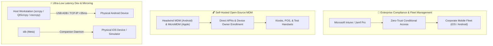

  

  
  
  
  
  
  
  
  

---

# 📱 Awesome Mobile Device Management & Screen Mirroring

> 🚀 **A curated directory of top-tier SaaS platforms, open-source protocols, and self-hosted utilities for Mobile Device Management (MDM), Unified Endpoint Management (UEM), native Android/iOS screen mirroring, and low-latency physical device control.**

Whether you are an Android or iOS engineer conducting automated testing, an IT administrator managing corporate device fleets and kiosks, a live streamer casting high-framerate mobile gaming, or a privacy-conscious power user requiring local zero-cloud ADB screen mirroring without accounts or subscriptions, this guide indexes the modern mobile control ecosystem.

---

## 📑 Table of Contents

- [📊 Sector Overview & Market Dynamics](#-sector-overview--market-dynamics)
- [🏢 SaaS & Enterprise Hosted Platforms](#-saas--enterprise-hosted-platforms)
- [💻 Open-Source GitHub Projects](#-open-source-github-projects)
- [🧩 Architecture & Stack Recommendations](#-architecture--stack-recommendations)
- [📈 Star History](#-star-history)
- [💖 Support & Sponsoring](#-support--sponsoring)
- [🤝 How to Contribute](#-how-to-contribute)
- [⚖️ Disclaimer & Security Considerations](#️-disclaimer--security-considerations)
- [🏷️ SEO Keywords & Discovery Tags](#️-seo-keywords--discovery-tags)

---

## 📊 Sector Overview & Market Dynamics

The global **Mobile Device Management (MDM)** and **Unified Endpoint Management (UEM)** sector is valued at **$9.4 Billion in 2024** and is projected to expand to **$32.4 Billion by 2030**, compounding at an aggressive **CAGR of ~22.8%**, fueled by remote workforce expansion, BYOD policies, and enterprise IoT/kiosk deployments. Concurrently, the consumer and developer screen-mirroring and low-latency remote display streaming market represents an addressable **$4.1 Billion** segment. 

From a competitive standpoint, the enterprise mobility and compliance tier is **moderately concentrated** around dominant hyperscalers and specialist ecosystems (such as Microsoft Intune for mixed fleets and Jamf for Apple enterprise environments). In contrast, the ad-hoc screen mirroring, developer testing, and reverse-control tier remains **moderately fragmented**, balancing ubiquitous zero-cloud open-source reference standards like `scrcpy` against commercial multi-screen streaming suites like AirDroid Cast and TeamViewer.

---

## 🏢 SaaS & Enterprise Hosted Platforms

The table below outlines leading commercial SaaS and cloud-managed endpoint management and mirroring platforms, sorted in descending order by **Company Valuation / Annual Revenue**.

| 🏢 Platform / Product | 📈 Company Size (Valuation / Revenue) | 💰 Specific Starting Pricing | 🎁 Free Tier / Trial Limit | 📱 Target OS & Fleet Focus | ⚡ Key Capabilities |
| :--- | :--- | :--- | :--- | :--- | :--- |
| **[Microsoft Intune](https://www.microsoft.com/en-us/security/business/endpoint-management/microsoft-intune)** | **Microsoft Corp.** • Valuation: **$3.1 Trillion** • Annual Revenue: **$245+ Billion** | **$8.00/user/month** (Plan 1 standalone) or included in M365 Business Premium ($22.00/user/mo); Intune Suite add-on at **$10.00/user/month** | **30-Day Free Trial** • Full access for up to 25 user licenses • Requires business work email • Full MDM/MAM feature set | Android, iOS, iPadOS, macOS, Windows, ChromeOS, Linux | Enterprise UEM, zero-trust conditional access, mobile application containerization (MAM), remote device wipe, compliance policy enforcement |
| **[ManageEngine MDM Plus](https://www.manageengine.com/mobile-device-management/)** | **Zoho Corporation** • Valuation: **~$10 Billion** • Annual Revenue: **~$1.4 Billion** | **$1.25/device/month** (Cloud Standard, min 25 devices = $31.25/mo) or **$495/year for 50 devices** on-premises (~$0.82/dev/mo) | **Free Forever Edition** • Up to **25 devices free forever** • Complete MDM feature set • No credit card or expiration | Android, iOS, iPadOS, macOS, Windows, ChromeOS, tvOS | Complete device lifecycle management, silent app installation, remote lock/wipe, dedicated kiosk mode, geofencing, peripheral controls |
| **[TeamViewer](https://www.teamviewer.com/)** | **TeamViewer SE** (ETR: TMV) • Valuation: **~$2.7 Billion** • Annual Revenue: **€670M (~$720M)** | **$24.90/month** ($298.80 billed annually) for Single User; Multi-user Business tier at **$50.90/month** ($610.80/year) | **Free Forever (Personal Use)** • Non-commercial usage only • 1 concurrent session • Automated session timeout when prolonged usage detected | Android (100+ OEMs via Host app), iOS, iPadOS, Windows, macOS, Linux | Unattended 24/7 background mobile access, remote screen control, two-way file transfer, Intune & MaaS360 MDM integrations |
| **[Jamf Pro / Jamf Now](https://www.jamf.com/)** | **Jamf Holding Corp.** (NASDAQ: JAMF) • Valuation: **~$1.8 Billion** • Annual Revenue: **~$560 Million** | **$4.00/device/month** (Jamf Now billed annually); Jamf Pro at **$7.17/device/month** for iOS/iPadOS/tvOS and **$13.33/device/month** for macOS | **Free Forever (First 3 Devices)** • Jamf Now includes 3 devices free forever • **14-Day Free Trial** with unlimited devices for Jamf Pro | Apple Ecosystem (iOS, iPadOS, macOS, tvOS, watchOS, visionOS) | Apple-first enterprise zero-touch deployment via Apple Business Manager, payload push, inventory reporting, institutional passcode lock |
| **[Scalefusion](https://scalefusion.com/)** | **ProMobi Technologies** • Valuation: **~$100 Million** • Annual Revenue: **~$25 Million** | **$2.00/device/month** (Starter tier billed annually); Business plan at **$3.50/device/month**; Enterprise tier at **$5.00/device/month** | **14-Day Free Trial** • Unlimited access for up to 50 devices • Full enterprise feature tier • No credit card required | Android, iOS, iPadOS, Windows, macOS, Linux | Single & multi-app kiosk lockdown, remote screen cast & control, VoIP communication, location tracking, deep hardware peripheral restrictions |
| **[ApowerMirror](https://www.apowersoft.com/phone-mirror)** | **Wangxu Technology** (Apowersoft) • Valuation: **~$80 Million** • Annual Revenue: **~$30 Million** | **$4.99/month** (promo), **$29.95/year**, or **$59.95 lifetime** (1 PC / 2 mobile devices); Commercial Team tier at **$79.95/year** | **Free Forever Tier** • Max **10 minutes per session** • Watermarked display output • 720p maximum resolution • 1 device connection at a time | Android, iOS, Windows, macOS, Android TV | Low-latency phone-to-PC & phone-to-TV streaming, reverse PC keyboard & mouse control, wireless whiteboard annotations, game casting |
| **[AirDroid Cast](https://airdroidcast.net/)** | **Sand Studio** (SAND STUDIO PTE. LTD.) • Valuation: **~$40 Million** • Annual Revenue: **~$15 Million** | **$1.67/month** ($19.99 billed annually) for Basic; Standard with remote control at **$2.00/month** ($23.99/year); Premium at **$3.25/month** | **Free Forever Tier** • Local Wi-Fi / WLAN casting only • Up to 5 simultaneous devices • Remote control & USB cable modes require paid tier | Android, iOS, Windows, macOS, Web Browser (AirDroid Cast Web) | 5-device simultaneous multi-casting to one display, internal device audio streaming, two-way audio talkback, remote Android/iOS PC touch control |
| **[Vysor](https://www.vysor.io/)** | **ClockworkMod LLC** • Valuation: **~$8 Million** • Annual Revenue: **~$2.5 Million** | **$2.50/month**, **$10.00/year**, or **$40.00 one-time lifetime license** per developer account | **Free Forever Tier** • Standard Definition (SD) tethered mirroring • Basic ADB keyboard & click input • High-res, wireless Wi-Fi, & drag-and-drop transfer locked | Android, iOS, Windows, macOS, Linux, ChromeOS (Web client) | Physical developer device mirroring, ADB passthrough, Vysor Share (share device screen & ADB port over web URL), drag-and-drop APK installation |

---

## 💻 Open-Source GitHub Projects

The following curated open-source projects provide native Android screen mirroring, Apple MDM services, reverse tethering, containerized Android instances, and multi-device testing farms. 

Repos are sorted in descending order by **GitHub Star Counts** ⭐.

### 1. [scrcpy](https://github.com/Genymobile/scrcpy) 
- 📌 **Description**: The industry standard for native Android screen mirroring and control over USB or TCP/IP. Requires no root, no app installed on the device, no accounts, and no internet connection.
- ⚡ **Performance**: 30–120 FPS, 1920×1080+ native resolution, 35–70 ms ultra-low latency, and ~1-second instant startup.
- 🛠️ **Core Features**: Audio forwarding (Android 11+), video recording, screen-off mirroring, bidirectional clipboard copy-paste, virtual secondary display, camera mirroring (Android 12+), Linux webcam emulation (v4l2), physical HID keyboard/mouse simulation, and USB OTG mode.
- 🎯 **Best For**: Developers, automation engineers, and security-conscious users seeking the fastest, cleanest, non-intrusive Android device bridge.

### 2. [QtScrcpy](https://github.com/barry-ran/QtScrcpy) 
- 📌 **Description**: High-performance, cross-platform Android control engine with a native C++ / Qt GUI layer.
- ⚡ **Performance**: Direct C++ implementation matching native scrcpy low latency with configurable H.264/H.265 bitrates.
- 🛠️ **Core Features**: Multi-device batch management, custom key-mapping (play Android mobile games using keyboard and mouse without emulators), macro recording, customizable shortcut panels, and background batch script execution.
- 🎯 **Best For**: Gamers, QA test automation teams, and power users needing simultaneous multi-device controls without typing terminal commands.

### 3. [STF (Smartphone Test Farm)](https://github.com/openstf/stf) 
- 📌 **Description**: Cloud-native, browser-based physical smartphone test farm designed to control, debug, and monitor Android and iOS devices remotely.
- ⚡ **Performance**: Real-time remote browser display over WebSockets with device pool allocation and queue management.
- 🛠️ **Core Features**: Interactive touch input from web browser, remote ADB connect forwarder, automated APK installation, shell execution, device logcat viewing, and REST API for CI/CD test harness integration.
- 🎯 **Best For**: Enterprise QA teams, mobile DevOps pipelines, and organizations maintaining self-hosted physical device clouds.

### 4. [escrcpy](https://github.com/viarotel-org/escrcpy) 
- 📌 **Description**: Polished, modern graphical client for scrcpy powered by Electron, Vue.js, and TypeScript.
- ⚡ **Performance**: Wraps native scrcpy streaming binaries while providing a modern, visual control panel.
- 🛠️ **Core Features**: Device connection manager, wireless IP scanner and one-click pairing, audio toggle switches, configurable bitrate/resolution profiles, window framing, and screenshot/recording managers.
- 🎯 **Best For**: End users and developers who prefer an intuitive, modern desktop UI over command-line terminal arguments.

### 5. [gnirehtet](https://github.com/Genymobile/gnirehtet) 
- 📌 **Description**: High-speed reverse tethering for Android over USB. Provides internet access from the host PC to an Android device.
- ⚡ **Performance**: Native Rust and Java implementation leveraging Android VPN service APIs for near-line-speed networking.
- 🛠️ **Core Features**: Requires no root access, works across Linux, macOS, and Windows, automatically injects routing rules, and seamlessly keeps devices online in air-gapped test labs.
- 🎯 **Best For**: Testing mobile devices in Faraday cages, isolated corporate networks, or labs lacking Wi-Fi coverage.

### 6. [redroid (Remote Android in Docker)](https://github.com/remote-android/redroid-doc) 
- 📌 **Description**: GPU-accelerated AIC (Android in Cloud) runtime running isolated Android instances inside Docker containers.
- ⚡ **Performance**: Native hardware acceleration via Intel/AMD/Nvidia GPUs and Mesa Gallium drivers for high-framerate rendering.
- 🛠️ **Core Features**: Runs Android 8.1 through Android 14 images, exposes standard ADB interfaces, supports WebRTC and scrcpy client streaming, and scales horizontally across cloud infrastructure.
- 🎯 **Best For**: Cloud gaming services, large-scale mobile bot farms, automated continuous app testing, and virtual mobile infrastructure.

### 7. [idb (iOS Development Bridge)](https://github.com/facebook/idb) 
- 📌 **Description**: Powerful command-line interface and daemon developed by Meta for automating, inspecting, and controlling physical iOS devices and simulators.
- ⚡ **Performance**: Low-overhead companion daemon running on macOS with a cross-platform client (Linux/macOS).
- 🛠️ **Core Features**: Remote screen video capture, touch events and button press simulation, file synchronization, application lifecycle management, accessibility tree inspection, and port forwarding.
- 🎯 **Best For**: iOS test automation engineers, CI/CD runners, and distributed cross-platform mobile testing environments.

### 8. [sndcpy](https://github.com/rom1v/sndcpy) 
- 📌 **Description**: Dedicated Android audio forwarding tool for Android 10+ devices over ADB.
- ⚡ **Performance**: Minimal buffer delay using Android's native MediaProjection audio capture API and VLC audio playback.
- 🛠️ **Core Features**: Streams device audio directly to the computer speakers, requires no root access, and operates alongside scrcpy.
- 🎯 **Best For**: Users of scrcpy on older setups or developers specifically requiring isolated audio stream capture.

### 9. [guiscrcpy](https://github.com/srevinsaju/guiscrcpy) 
- 📌 **Description**: Feature-packed open-source Python GUI wrapper for scrcpy designed for cross-platform utility.
- ⚡ **Performance**: Direct invocation of scrcpy binaries with zero CPU overhead from the GUI wrapper during streaming.
- 🛠️ **Core Features**: Floating side panel with hardware navigation buttons (Back, Home, App Switcher), swipe panel for gesture execution, multi-device management with color coding, and persistent configuration presets.
- 🎯 **Best For**: Power users navigating phones with damaged screens or physical buttons directly from their workstation.

### 10. [MicroMDM](https://github.com/micromdm/micromdm) 
- 📌 **Description**: Lightweight open-source Mobile Device Management (MDM) server for Apple devices (macOS, iOS, iPadOS, and tvOS) written in Go.
- ⚡ **Performance**: High-concurrency Go microservice designed for zero-latency Apple Push Notification service (APNs) dispatch.
- 🛠️ **Core Features**: Apple MDM protocol compliance, Apple Device Enrollment Program (DEP) / Automated Device Enrollment (ADE) integration, configuration profile deployment, and remote lock/wipe commands.
- 🎯 **Best For**: Sysadmins and engineering teams wanting to build custom, self-hosted Apple device fleet management stacks without per-seat licensing fees.

### 11. [ws-scrcpy](https://github.com/NetrisTV/ws-scrcpy) 
- 📌 **Description**: Web-based scrcpy client that streams Android screens directly to any modern web browser via WebSockets and Broadway.js / H.264 decoders.
- ⚡ **Performance**: Browser-native MSE (Media Source Extensions) decoding with interactive low-latency mouse and keyboard control.
- 🛠️ **Core Features**: No desktop client installation needed for end users, multi-device web dashboard, touch event emulation, and containerized Docker deployment support.
- 🎯 **Best For**: Remote browser-based customer tech support, internal device testing portals, and web app device demonstration.

### 12. [Headwind MDM](https://github.com/h-mdm/hmdm-server) 
- 📌 **Description**: Open-source Mobile Device Management (MDM) and kiosk software specifically engineered for corporate Android device fleets.
- ⚡ **Performance**: Java/Angular web control panel managing thousands of distributed Android edge devices.
- 🛠️ **Core Features**: Silent enterprise APK updates, device owner provisioning via QR code, GPS location tracking, kiosk launcher lockdown, Wi-Fi configuration push, and remote log retrieval.
- 🎯 **Best For**: Managing enterprise Android fleets such as POS terminals, logistics handhelds, warehouse barcode scanners, and public kiosks.

### 13. [uiCY](https://github.com/DeRadian/uicy) 
- 📌 **Description**: Lightweight Python GUI bundling scrcpy video casting with sndcpy audio capture over a single USB connection.
- 🛠️ **Core Features**: Streamlined one-click audio + video mirroring, designed for budget gamers and streamers needing an alternative to expensive capture cards at 480p/720p.
- 🎯 **Best For**: Budget mobile streamers and content creators.

### 14. [rscrcpy](https://github.com/naocancell/rscrcpy) 
- 📌 **Description**: Specialized root-enabled fork of scrcpy designed to bypass Android's `FLAG_SECURE` restrictions.
- 🛠️ **Core Features**: Captures and mirrors protected display surfaces that normally block screenshots and recordings (such as banking interfaces and DRM media players).
- 🎯 **Best For**: Security auditors, reverse engineers, and penetration testers operating on rooted test handsets.

---

## 🧩 Architecture & Stack Recommendations

Depending on your security posture, platform requirements, and budget, consider these recommended architecture stacks:

- **For Enterprise IT & Fleet Governance**: Pair **[Microsoft Intune](https://www.microsoft.com/en-us/security/business/endpoint-management/microsoft-intune)** or **[Jamf Pro](https://www.jamf.com/)** for compliance, identity federation, and zero-touch setup, augmented with **[TeamViewer](https://www.teamviewer.com/)** for unattended remote helpdesk sessions.
- **For Open-Source & Self-Hosted Infrastructure**: Deploy **[Headwind MDM](https://github.com/h-mdm/hmdm-server)** for corporate Android kiosks and **[MicroMDM](https://github.com/micromdm/micromdm)** for Apple devices, eliminating recurring per-seat SaaS costs.
- **For Developers, QA Automation, & Test Labs**: Use **[scrcpy](https://github.com/Genymobile/scrcpy)** or **[QtScrcpy](https://github.com/barry-ran/QtScrcpy)** for physical Android hardware testing, **[idb](https://github.com/facebook/idb)** for iOS testing, and **[STF](https://github.com/openstf/stf)** for distributed web-accessible device farms.

---

## 📈 Star History

---

## 💖 Support & Sponsoring

A heartfelt **thank you** to all engineers, open-source maintainers, and community contributors who push the boundaries of high-performance mobile device management and native screen casting! 🙌

If you find this repository helpful for your projects, research, or daily workflows:
- ⭐ **Star this repository** to help other engineers discover it.
- 🍴 **Fork it** and contribute new tools, benchmarks, and updates.
- 📢 **Share it** on tech forums, Discord communities, and LinkedIn.
- ☕ **Support development & research**: Consider buying a coffee or sponsoring maintenance through the [GitHub Sponsor Dashboard](https://github.com/sponsors/ishandutta2007).

  

---

## 🤝 How to Contribute

Contributions are warmly welcomed! To suggest a new open-source project, SaaS platform, or update existing details:

1. 🍴 **Fork the repository** to your GitHub account.
2. 🌿 **Create a descriptive feature branch**: `git checkout -b feature/add-new-tool`.
3. 📝 **Add or edit entries in `README.md`**:
   - Maintain table formats and descending star/valuation rankings.
   - For SaaS tools: Include specific starting pricing and exact free tier/trial limits.
   - For Open-Source tools: Include the official GitHub stars social badge linked to the repository stargazers page.
4. ✅ **Ensure accuracy**: Verify links, pricing plans, and compatibility details.
5. 🚀 **Submit a Pull Request** with a concise description of your additions.

---

## ⚖️ Disclaimer & Security Considerations

- 🛡️ **Community Curated**: This repository is a curated informational directory and does not constitute a commercial endorsement.
- 🔒 **Security of USB Debugging & ADB**: Enabling Developer Options and USB Debugging grants deep access to your handset. Never authorize USB debugging prompts from unknown computers or insecure public charging stations.
- 🌐 **Network Exposure on TCP/IP**: When enabling wireless ADB (`adb tcpip 5555`), the device port is reachable across your local subnet without additional encryption unless paired via modern Android 11+ TLS pairing.
- 🏢 **Corporate MDM Capabilities**: Enrolling personal devices into corporate MDM / UEM profiles (Intune, Jamf, Scalefusion) may grant IT administrators permission to enforce passcodes, install enterprise certificates, and remotely wipe device contents. Review organizational BYOD policies carefully.

---

## 🏷️ SEO Keywords & Discovery Tags

`mobile-device-management` • `screen-mirroring` • `android-mirroring` • `scrcpy` • `remote-control` • `enterprise-mdm` • `unified-endpoint-management` • `uem` • `ios-mirroring` • `vysor-alternative` • `scrcpy-gui` • `android-adb-screen-cast` • `device-farm` • `smartphone-test-farm` • `low-latency-display` • `reverse-tethering` • `kiosk-mode-android` • `apple-mdm` • `micromdm` • `headwind-mdm`
# Awesome-Mobile-Device-Management-Mirroring

